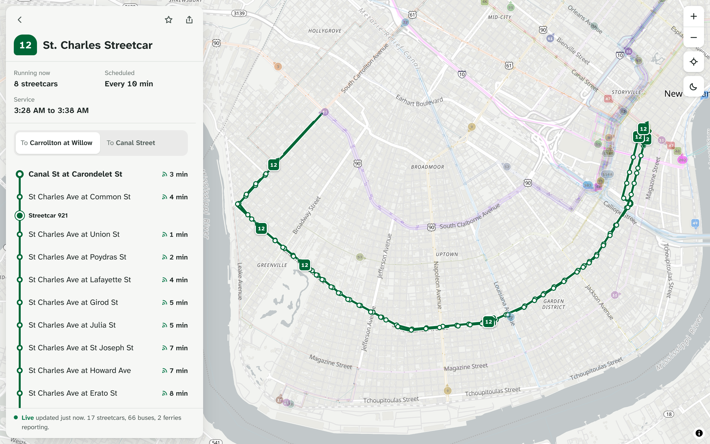
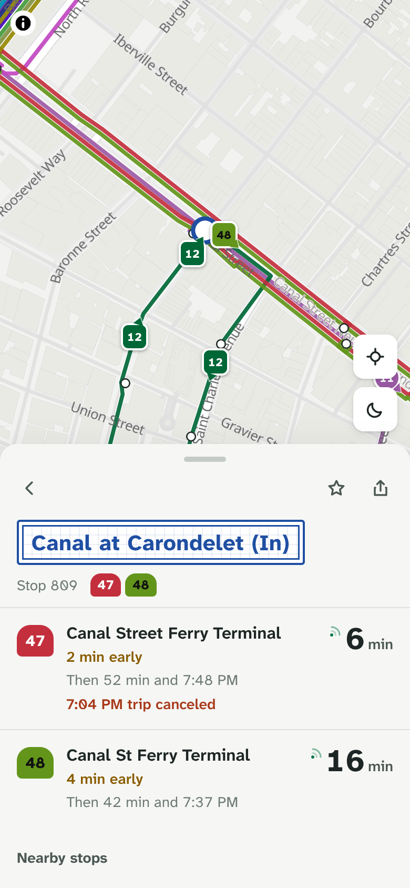

# New Orleans RTA Live Map

A realtime transit map for New Orleans: the full RTA network (buses, streetcars
and ferries) with live vehicle positions, arrival times at every stop, and a
stop-by-stop view of each route.

Live at **https://nola-transit-live.pages.dev/**





## What it does

**Arrival times at any stop.** Pick a stop and see what's coming next, grouped
by route and direction.

Times come from RTA's own GTFS-realtime predictions, merged with the published
timetable so every stop always shows something useful. Each time says where it
came from:

| Mark | Meaning |
| --- | --- |
| Live symbol | RTA's prediction from the vehicle's reported position, with how late or early it's running |
| No symbol | The timetable. Nothing live covers this trip yet |

If the live feed stops updating, the app falls back to the timetable and says
so, instead of showing old predictions as if they were current. Canceled trips
and stops skipped by a detour stay in the list, marked, so nobody waits for a
bus that isn't coming.

**Route detail.** Each route shows its stops in order, the vehicles currently
between them, the next live arrival at each stop, and any detours in effect.

**Vehicle tracking.** Vehicles glide along the street between updates instead
of jumping. Tap one to see its next stops.

**Detours and alerts.** RTA's published detours are drawn on the map, and the
stops they skip are marked everywhere they appear.

**Saved stops, nearby stops and search.** Save the stops you use, find stops
near you, or search by street, route or the stop number on the sign.

**Works offline.** It installs as an app, and opens without a connection with
scheduled times.

**Links.** Every screen is a URL (`/stop/1047`, `/route/12?dir=1`,
`/vehicle/460`), so anything can be shared or bookmarked.

## Running locally

```bash
npm install
npm run dev
```

The dev server runs the same `/api/realtime` code as production and talks to
RTA's live feed directly. To work offline, replay a recorded snapshot:

```bash
REALTIME_FIXTURE=tests/fixtures/realtime.json npm run dev
```

```bash
npm run build      # production build
npm run preview    # serve the build
npm run cf:dev     # run the Cloudflare Pages build locally
npm run cf:deploy  # build and deploy
```

## Data

The timetable is built from RTA's published GTFS feed:

```bash
npm run data -- --fetch   # download the latest feed and rebuild public/data
```

The build refuses to use a feed that has expired, and a GitHub Action checks
for a new one every week and commits it. An out-of-date timetable gives wrong
times without any error, so this runs automatically rather than relying on
someone remembering.

`scripts/gtfs/build.ts` produces:

- **Patterns.** Every distinct path a route runs, with its exact shape and stop
  sequence, so branches and short trips are drawn and timed correctly.
- **Timetables per pattern**, loaded only when a stop needs them. All 9,700+
  trips fit in under 400 KB because trips share running-time profiles.
- **Route lines with parallel offsets.** Where several routes share a street,
  each gets its own lane, drawn on the GPU.
- **Clean stop names.** "St. Charles Ave.", "St Charles Ave" and "Aveat" become
  one consistent style.
- **Contrast-corrected route colours**, so pale colours still read on the map.

Live data comes from RTA's GTFS-realtime feeds (vehicles, trip updates,
alerts and detours). A Cloudflare Pages Function decodes them and caches the
result at the edge for 10 seconds, so every rider shares one request to RTA.

## Checking

```bash
npm test             # unit tests
npm run test:e2e     # browser tests, desktop and phone
npm run check:live   # compare against RTA's own countdowns right now
```

`check:live` builds a snapshot from the live feed, computes arrivals with the
app's code, and compares them with what RTA's BusTime site shows for the same
stops. It fails if the timetable no longer matches the live feed.

## Design

The map is the interface. Route colour is the only saturated thing on it, so
colour always means a route. The rest stays quiet: one ink colour, hairline
rules, and two accents with fixed meanings, cobalt for anything you can press
and green for live times.

The stop name plaque borrows from the blue-and-white street name tiles set into
New Orleans sidewalks. Type is Atkinson Hyperlegible Next, designed for low-vision
readers, which suits reading a screen at a sunny bus stop. Times use tabular
figures so countdowns don't shift as they change.

## Structure

```
scripts/gtfs/         timetable build pipeline
shared/realtime/      GTFS-realtime decoding and the API handler
functions/api/        Cloudflare Pages Function
src/lib/              pure logic: time zones, arrivals, vehicles, search
src/app/              data loading, polling, routing, preferences
src/map/              MapLibre layers and vehicle markers
src/views/, src/ui/   screens and components
tests/                unit and browser tests
```

`src/lib/` has no browser or map code, so it's tested directly in Node.
