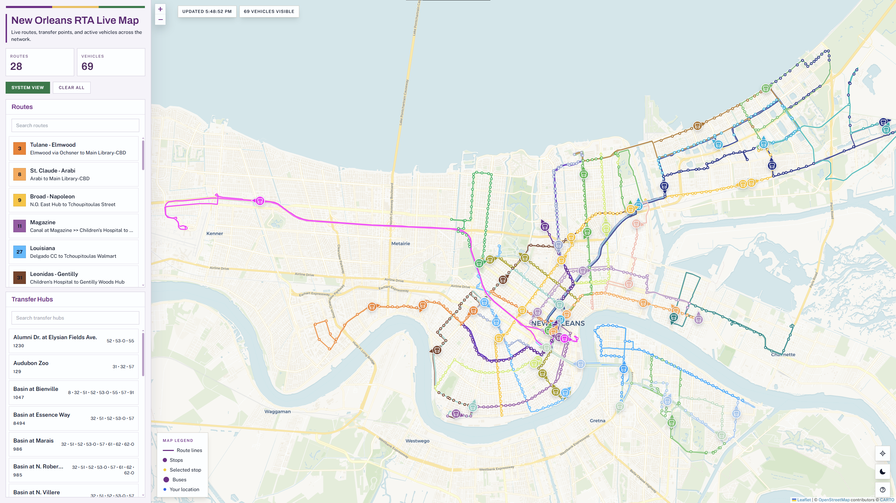
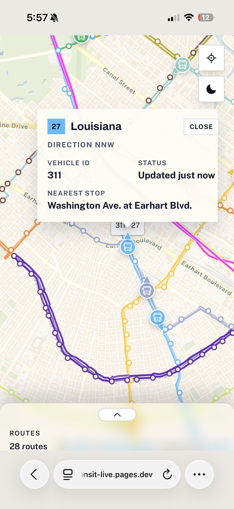

# New Orleans RTA Live Map (https://nola-transit-live.pages.dev/)

New Orleans RTA Live Map is a realtime transit map for New Orleans built with Vite, React, Leaflet, and Cloudflare Pages. It renders the full route network, transfer hubs, route filtering, live vehicle positions, and map-based bus details in a single browser app.

### Desktop



### Mobile



## Features

- Official route and stop network
- Live vehicle positions
- Transfer hub and stop search

## Running Locally

```bash
npm install
npm run dev
```

To preview the production build:

```bash
npm run build
npm run preview
```

To run the Cloudflare Pages version locally:

```bash
npm run build
npm run cf:dev
```

## Deploying

This project is set up for Cloudflare Pages.

```bash
npm run build
npm run cf:deploy
```

## Data

The static network is generated from the NORTA GTFS feed and stored in `public/data/norta-network.json`.

Supporting scripts:

```bash
node scripts/build-norta-data.mjs
node scripts/build-demo-vehicles.mjs
```
